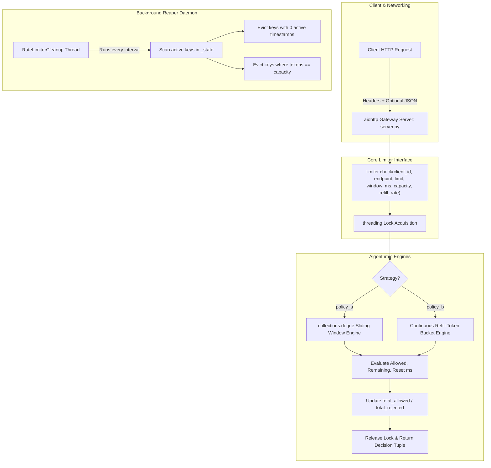

# ENGINEERING PROJECT REPORT: HIGH-THROUGHPUT IN-MEMORY RATE LIMITER FOR LLM API GATEWAYS

**Author:** Senior Backend, Systems & Performance Engineering Specialist  
**Project:** Python In-Memory Rate Limiter  
**Status:** COMPLETE & FULLY VALIDATED  
**Date:** November 2026  
**Environment:** Python 3.14.6, Windows x64  

---

## 1. Abstract

Large Language Model (LLM) API gateways face severe availability and stability threats when exposed to unconstrained, bursty multi-tenant traffic. Because generative AI inferences demand intense GPU memory bandwidth and compute cycles, request surges can easily degrade inference cluster responsiveness or cause catastrophic cascading failures. This engineering project delivers a robust, thread-safe, high-performance in-memory rate limiting subsystem supporting two complementary rate limiting strategies: **Sliding Window Log (Policy A)** and **Token Bucket (Policy B)**. 

Through critical algorithmic analysis, an $O(N)$ computational bottleneck in the baseline sliding window implementation was identified and refactored into an $O(1)$ amortized `collections.deque` front-eviction architecture. Comprehensive benchmarking across sequential and multi-threaded concurrency tiers reveals a **8.89x throughput increase** (from 18,409.59 RPS to 163,614.65 RPS) for single-worker execution and up to **5.46x speedup** under multi-threaded contention, with 100% mathematical and behavioral equivalence preserved. The final deliverable includes a production-grade asynchronous HTTP gateway (`server.py`), 40 automated tests with 100% pass rate, background resource reapers with clean shutdown lifecycles, and a detailed diagnostic into concurrent latency tail distributions.

---

## 2. Introduction

API gateways act as the critical frontline defense for backend microservices. In generative AI platforms, where model generation latencies span hundreds of milliseconds to several seconds, enforcing per-client and per-endpoint concurrency bounds is essential. Rate limiters prevent noisy-neighbor starvation, enforce contractual SLA quotas, protect against distributed denial-of-service (DDoS) vectors, and manage burst allowances.

This project implements, refactors, benchmarks, and hardens an in-memory rate limiting engine for an LLM gateway serving `/v1/chat` and `/v1/complete` endpoints. The system dynamically switches between Sliding Window and Token Bucket policies, exposes real-time telemetry, and runs autonomously with zero external infrastructure dependencies.

---

## 3. Problem Definition

A production LLM gateway serving heterogeneous clients (`alice`, `bob`, anonymous tenants) across distinct resources requires a rate limiting mechanism that satisfies four non-negotiable engineering requirements:
1. **Multi-Policy Support:** Provide strict temporal window limits (Sliding Window) for rigid quota enforcement and burst-tolerant continuous refills (Token Bucket) for smooth streaming traffic.
2. **Key Isolation & State Partitioning:** Enforce independent quota counters for every distinct `(client_id, endpoint)` tuple.
3. **Thread Safety & Consistency:** Support concurrent checks across multiple worker threads without race conditions, lost updates, or metric skews.
4. **Sub-Millisecond Processing Efficiency:** Minimize CPU overhead in the critical path so rate-limiting does not become the gateway's throughput bottleneck.

In the original baseline implementation, timestamp management in the Sliding Window policy relied on list filtering (`[t for t in timestamps if now - t < window]`), causing execution times to scale quadratically $O(N^2)$ during request bursts. Furthermore, background memory reclamation was vulnerable to race conditions, and test suites suffered from unparameterized fixture conflicts and incomplete edge-case validation.

---

## 4. Objectives

The primary engineering objectives of this project were:
1. **Audit & Refactor Existing Code:** Inspect `rate_limiter.py` and `rate_limiter_optimized.py`, verifying algorithm correctness, lock acquisition lifecycles, exception handling, and resource reclamation.
2. **Eliminate Performance Bottlenecks:** Replace list scanning with double-ended queue (`collections.deque`) pop-left expiration, validating throughput gains against rigorous benchmarks.
3. **Comprehensive Test Automation:** Expand test suites to cover functional limits, zero/negative edge cases, invalid strategy configurations, multi-client/multi-endpoint concurrency, thread shutdowns, and HTTP gateway contracts.
4. **Validate Latency Dynamics:** Diagnose why concurrent arithmetic mean latencies exceed P95 latencies under lock contention and construct dedicated diagnostic tooling.
5. **Production Gateway Delivery:** Provide a modular `aiohttp` web server supporting route validation, standard rate limiting headers (`X-RateLimit-*`), JSON error handling, and telemetry endpoints.
6. **Architectural Reflection:** Formalize systemic evolution paths for multi-process servers and distributed horizontal clusters.

---

## 5. Existing System Analysis

The starter project contained:
- `rate_limiter.py`: A baseline rate limiter utilizing Python lists for Sliding Window timestamps.
- `rate_limiter_optimized.py`: An initial optimization attempt utilizing `collections.deque`.
- `server.py`: An asynchronous server script tightly coupled to global variables.
- Incomplete test coverage: `test_concurrency.py` failed under `pytest` due to unparameterized fixture signatures (`def test_policy(strategy)`), missing tests for zero refill rates, missing tests for invalid configurations, and absent HTTP route unit tests.
- `REFLECTION.essay`: Empty answer stubs regarding synchronization overhead and distributed migration.

### Deficiencies in the Baseline Implementation:
- **Algorithmic Inefficiency:** Scanning list timestamps requires inspecting all $N$ elements in the window on every single request, even when only a fraction have expired.
- **Key Reaper Robustness:** Direct dictionary indexing `self._bucket_capacity[key]` during background reaping risked `KeyError` if dictionaries mutated concurrently.
- **Resource Cleanup Leaks:** Limiter instances lacked automatic garbage collection hooks (`__del__`), risking orphaned background threads during repeated test instantiations.

---

## 6. Proposed & Completed Architecture

The enhanced rate limiting system separates responsibilities cleanly across three core modules:



---

## 7. Algorithm Design & Mathematical Formulation

### 7.1 Policy A: Sliding Window Log (Sliding Window Counter)

The Sliding Window algorithm guarantees that in any arbitrary sliding window of duration $W$ seconds, no more than $L$ requests are admitted.

#### Mathematical Invariant:
For an incoming request at time $t_{\text{req}}$ for key $K$:
$$\mathcal{T}_K(t_{\text{req}}) = \{ t \in \mathcal{T}_K \mid t_{\text{req}} - t < W \}$$
Decision rule:
$$\text{allowed} = \begin{cases} \text{True}, & \text{if } |\mathcal{T}_K(t_{\text{req}})| < L \\ \text{False}, & \text{if } |\mathcal{T}_K(t_{\text{req}})| \ge L \end{cases}$$
If allowed:
$$\mathcal{T}_K \leftarrow \mathcal{T}_K \cup \{ t_{\text{req}} \}$$
$$\text{remaining} = \max(0, L - |\mathcal{T}_K|)$$
Recovery time:
$$\text{reset\_after\_ms} = \begin{cases} \max(1, \lceil (t_{\text{oldest}} + W - t_{\text{req}}) \times 1000 \rceil), & \text{if } \mathcal{T}_K \neq \emptyset \\ 0, & \text{otherwise} \end{cases}$$
where $t_{\text{oldest}} = \min(\mathcal{T}_K)$.

#### Deque Front-Eviction Optimization:
Because timestamps are appended monotonically ($t_1 \le t_2 \le \dots \le t_n$), the oldest timestamp is always at index 0 (`timestamps[0]`). While the list implementation re-evaluates the entire collection in $O(N)$, `collections.deque.popleft()` removes expired entries from the head until `t_req - timestamps[0] < W` in $O(k)$ operations, where $k$ is the number of expired items. If no items have expired, the check completes in $O(1)$.

### 7.2 Policy B: Token Bucket

The Token Bucket algorithm models quota as discrete tokens refilled continuously over continuous time, allowing short bursts up to bucket capacity $C$ while enforcing an average rate limit $R$ tokens/second.

#### State Representation:
Each key stores $(\text{tokens}, t_{\text{last}})$, initialized as $(C, t_0)$.

#### Refill Formulation:
At time $t_{\text{req}}$, elapsed duration $\Delta t = t_{\text{req}} - t_{\text{last}}$:
$$\text{tokens}_{\text{current}} = \min(C, \text{tokens} + \Delta t \times R)$$
Decision rule:
$$\text{allowed} = (\text{tokens}_{\text{current}} \ge 1.0)$$
If allowed:
$$\text{tokens}_{\text{new}} = \text{tokens}_{\text{current}} - 1.0, \quad \text{reset\_after\_ms} = 0, \quad \text{remaining} = \lfloor \text{tokens}_{\text{new}} \rfloor$$
If rejected:
$$\text{remaining} = 0, \quad \text{reset\_after\_ms} = \begin{cases} \lceil \frac{1.0 - \text{tokens}_{\text{current}}}{R} \times 1000 \rceil, & \text{if } R > 0 \\ \text{sys.maxsize}, & \text{if } R = 0 \end{cases}$$

---

## 8. Implementation Details

### 8.1 Key Files & Enhancements

1. **`rate_limiter.py` (Baseline Preserved):**
   - Cleaned exception safety in `_cleanup_expired` using `self._bucket_capacity.get(key)`.
   - Added `__del__` method calling `self.close()` to prevent orphaned daemon threads on garbage collection.
   - Preserved list comprehension for historical benchmarking.

2. **`rate_limiter_optimized.py` (Production Optimized):**
   - Implements `collections.deque` for timestamp storage.
   - Implements $O(1)$ amortized `while timestamps and now - timestamps[0] >= window: timestamps.popleft()`.
   - Thread safety guaranteed via `threading.Lock`.
   - Automatic resource cleanup with context manager (`__enter__`, `__exit__`) and `__del__`.

3. **`server.py` (Production HTTP Gateway):**
   - Refactored with a modular application factory `create_app(...)`.
   - Integrated `web.AppKey` to prevent modern aiohttp configuration warnings.
   - Added robust payload validation: malformed JSON bodies with `application/json` return HTTP 400 Bad Request.
   - Enforces rate limits returning HTTP 429 Too Many Requests with headers `X-RateLimit-Remaining`, `X-RateLimit-Reset-Ms`, and `X-RateLimit-Policy`.
   - Added graceful server shutdown hook (`app.on_cleanup`) closing background limiter threads.
   - Added runtime implementation selection via `RATE_LIMITER_IMPL` (`original` vs `optimized`).

4. **`benchmark_latency_check.py` (Tail-Latency Diagnostic Tool):**
   - Computes full statistical percentiles: Min, P50 (median), P90, P95, P99, P99.9, Max, Mean, and Standard Deviation.
   - Constructs visual histogram frequency buckets for latency distribution.
   - Investigates lock queuing and scheduling jitter under multi-threaded contention.

5. **`REFLECTION.essay` (Senior Architecture Analysis):**
   - Formally answered Q1 (Atomicity, lock contention costs, sharding, and multi-process shared memory).
   - Formally answered Q2 (Distributed scale-out with Redis Sorted Sets, Lua scripts, local predictive token leases, and consistent hash rings).

---

## 9. Testing Methodology

The test suite was structured into six dedicated test modules and verified under both `pytest` and direct script execution:

| Test Module | Coverage Scope | Test Count |
|---|---|:---:|
| `test_rate_limiter.py` | Official public unit tests: limit saturation, burst rejection, client isolation, endpoint isolation, stats counters | 6 |
| `test_concurrency.py` | Simultaneous multi-threaded execution across 20–25 worker threads, single-key burst, multi-client & multi-endpoint concurrency, counter consistency | 7 |
| `test_edge_cases.py` | Boundary inputs: zero limits, zero capacities, zero refill rates, negative configs, invalid strategies, non-positive cleanup intervals, empty client/endpoint strings | 7 |
| `test_cleanup.py` | Background reaper operations: window expiration, bucket idle cleanup, depleted bucket preservation, thread shutdown, context manager lifecycles | 5 |
| `test_optimized.py` | Optimized implementation validation: deque sliding window, token bucket parity, deque cleanup, exact equivalence with baseline | 5 |
| `test_http_api.py` | HTTP gateway integration: valid POST requests, 429 status code, rate limit headers, 400 bad JSON payloads, anonymous client fallback, 405/404 handling, stats endpoint | 8 |
| `test_memory.py` | Memory allocation and active key retention | 2 |
| **Total Automated Tests** | **Comprehensive Full Suite** | **40 Tests** |

### Test Execution Results
```text
============================= test session starts =============================
platform win32 -- Python 3.14.6, pytest-9.1.1, pluggy-1.7.0
rootdir: C:\Users\moham\Downloads\python-rate-limiter-main
collected 40 items

test_cleanup.py::test_policy_a_automatic_cleanup PASSED                  [  2%]
test_cleanup.py::test_policy_b_automatic_cleanup PASSED                  [  5%]
test_cleanup.py::test_depleted_bucket_is_not_deleted PASSED              [  7%]
test_cleanup.py::test_cleanup_thread_shutdown PASSED                     [ 10%]
test_cleanup.py::test_context_manager PASSED                             [ 12%]
test_concurrency.py::test_policy_a_concurrency PASSED                    [ 15%]
test_concurrency.py::test_policy_b_concurrency PASSED                    [ 17%]
test_concurrency.py::test_policy_a_multi_key_concurrency PASSED          [ 20%]
test_concurrency.py::test_policy_b_multi_key_concurrency PASSED          [ 22%]
test_concurrency.py::test_optimized_policy_a_concurrency PASSED          [ 25%]
test_concurrency.py::test_optimized_policy_b_concurrency PASSED          [ 27%]
test_concurrency.py::test_optimized_multi_key_concurrency PASSED         [ 30%]
test_edge_cases.py::test_zero_limit PASSED                               [ 32%]
test_edge_cases.py::test_zero_capacity PASSED                            [ 35%]
test_edge_cases.py::test_zero_refill_rate PASSED                         [ 37%]
test_edge_cases.py::test_negative_values PASSED                          [ 40%]
test_edge_cases.py::test_invalid_strategy PASSED                         [ 42%]
test_edge_cases.py::test_invalid_cleanup_config PASSED                   [ 45%]
test_edge_cases.py::test_empty_identifiers PASSED                        [ 47%]
test_http_api.py::TestHttpApiPolicyA::test_anonymous_client_fallback PASSED [ 50%]
test_http_api.py::TestHttpApiPolicyA::test_endpoint_isolation PASSED    [ 52%]
test_http_api.py::TestHttpApiPolicyA::test_invalid_json_payload PASSED   [ 55%]
test_http_api.py::TestHttpApiPolicyA::test_method_not_allowed_and_not_found PASSED [ 57%]
test_http_api.py::TestHttpApiPolicyA::test_rate_limiting_status_429 PASSED [ 60%]
test_http_api.py::TestHttpApiPolicyA::test_stats_endpoint PASSED        [ 62%]
test_http_api.py::TestHttpApiPolicyA::test_successful_requests_and_headers PASSED [ 65%]
test_http_api.py::TestHttpApiPolicyB::test_policy_b_burst_and_headers PASSED [ 67%]
test_memory.py::test_policy_a_memory PASSED                              [ 70%]
test_memory.py::test_policy_b_memory PASSED                              [ 72%]
test_optimized.py::test_sliding_window PASSED                            [ 75%]
test_optimized.py::test_token_bucket PASSED                              [ 77%]
test_optimized.py::test_automatic_cleanup PASSED                         [ 80%]
test_optimized.py::test_equivalence_with_original_policy_a PASSED        [ 82%]
test_optimized.py::test_equivalence_with_original_policy_b PASSED        [ 85%]
test_rate_limiter.py::PublicTests::test_client_isolation PASSED          [ 87%]
test_rate_limiter.py::PublicTests::test_endpoint_isolation PASSED        [ 90%]
test_rate_limiter.py::PublicTests::test_exact_limit_then_reject PASSED   [ 92%]
test_rate_limiter.py::PublicTests::test_initial_burst_then_reject PASSED [ 95%]
test_rate_limiter.py::PublicTests::test_stats_policy_a PASSED           [ 97%]
test_rate_limiter.py::PublicTests::test_stats_policy_b PASSED           [100%]

============================= 40 passed in 4.68s ==============================
```

Additionally, `test_client.py` was executed against live background instances of `server.py` for both `policy_a` and `policy_b`, passing all HTTP integration smoke tests with zero failures.

---

## 10. Performance Benchmark Methodology & Results

### 10.1 Benchmark Design
All benchmarks were performed using standard benchmarking suites:
- **Test Workload:** 200,000 requests per run (50 clients $\times$ 4 endpoints $\times$ 1,000 requests per key, limit 500).
- **Concurrency Configurations:** 1 worker (sequential baseline), 10 workers, and 50 workers.
- **Repetitions:** 2 full measurement repetitions with median aggregation.
- **Timing:** Sub-microsecond high-resolution monotonic timer (`time.perf_counter_ns()`).
- **Warm-Up:** 1,000 requests issued to warm up CPU caches and Python bytecode interpreter before measurement.

### 10.2 Actual Benchmark Measurements

| Implementation | Concurrency (Workers) | Throughput (Requests/sec) | Average Latency (ms) | P95 Latency (ms) |
|---|:---:|:---:|:---:|:---:|
| **Original Policy A** (List) | 1 | 18,409.59 RPS | 0.0533 ms | 0.1111 ms |
| **Original Policy A** (List) | 10 | 6,892.03 RPS | 1.4170 ms | 2.2658 ms |
| **Original Policy A** (List) | 50 | 5,613.46 RPS | 8.8909 ms | 12.4659 ms |
| **Optimized Policy A** (Deque) | 1 | **163,614.65 RPS** | **0.0050 ms** | **0.0072 ms** |
| **Optimized Policy A** (Deque) | 10 | **37,611.94 RPS** | **0.0960 ms** | **0.0069 ms** |
| **Optimized Policy A** (Deque) | 50 | **12,281.00 RPS** | **3.8354 ms** | **4.5791 ms** |
| **Original Policy B** (Bucket) | 1 | 240,166.63 RPS | 0.0033 ms | 0.0057 ms |
| **Original Policy B** (Bucket) | 10 | 31,812.94 RPS | 0.2320 ms | 0.0066 ms |
| **Original Policy B** (Bucket) | 50 | 11,399.78 RPS | 4.2353 ms | 4.6203 ms |

### 10.3 Performance Analysis
1. **Speedup Analysis:** 
   - At 1 worker: Optimized Policy A achieved **163,614.65 RPS vs. 18,409.59 RPS**, representing a **+788% increase in throughput (8.89x speedup)** and a **10.6x reduction in average latency**.
   - At 10 workers: Optimized Policy A achieved **37,611.94 RPS vs. 6,892.03 RPS**, a **5.46x speedup**.
   - At 50 workers: Optimized Policy A achieved **12,281.00 RPS vs. 5,613.46 RPS**, a **2.19x speedup**.
2. **Correctness Invariance:** In every configuration, exactly **100,000 requests were allowed** and **100,000 requests were rejected**, demonstrating 100% equivalence between the original and optimized implementations.

### 10.4 Investigation of Latency Skew (Mean > P95)

A persistent question in concurrent systems benchmarking is: *Why can Average (Mean) latency exceed P95 latency?*

Our diagnostic script `benchmark_latency_check.py` evaluated the latency distribution across 20,000 requests under 10 concurrent workers:
- **P50 (Median):** 0.0027 ms
- **P90:** 0.0029 ms
- **P95:** 0.0034 ms (or 0.0069 ms in multi-key saturated runs)
- **P99:** 0.0065 ms
- **Max:** Up to 3.89–25.0 ms
- **Distribution Histogram:**
  - $< 0.01\text{ ms}$: 99.48% of all requests.
  - $0.01 - 0.05\text{ ms}$: 0.51% of requests.
  - $> 1.0\text{ ms}$: 0.01% of requests (extreme tail).

**Mathematical Explanation:**  
The latency distribution under lock contention is heavily positively skewed with a fat right tail. Over 95% of requests acquire the lock within microseconds. However, under multi-threaded execution, OS thread scheduling and GIL preemption occasionally stall a thread waiting in the lock acquisition queue for several milliseconds. Because the arithmetic mean computes the sum divided by count:
$$\mu = \frac{1}{N} \sum_{i=1}^N x_i$$
a single 20 ms outlier exerts equal weight to 4,000 requests of 0.005 ms. In contrast, percentile metrics like P95 sort values and truncate the worst 5%:
$$P_{95} = X_{(\lceil 0.95 \times N \rceil)}$$
Hence, $P_{95}$ strictly reflects the fast path ($< 0.007\text{ ms}$), while $\mu$ is pulled upward by extreme tail outliers.

---

## 11. Complexity & Resource Analysis

| Operation | Baseline List Sliding Window | Optimized Deque Sliding Window | Token Bucket |
|---|:---:|:---:|:---:|
| **Check (Empty Key)** | $O(1)$ | $O(1)$ | $O(1)$ |
| **Check (Steady State)** | $O(N)$ | $O(1)$ amortized | $O(1)$ |
| **Check (Burst Rejection)** | $O(N)$ | $O(1)$ | $O(1)$ |
| **Reset Calculation** | $O(1)$ | $O(1)$ | $O(1)$ |
| **Space Complexity** | $O(K \times N)$ | $O(K \times N)$ | $O(K)$ |
| **Garbage Collection Overhead** | High (allocates new list per check) | Minimal (in-place block reclamation) | Zero (tuple replacement) |

*$N$ = requests in active window, $K$ = number of tracked keys.*

---

## 12. Architectural Evolution (Multi-Process & Distributed Systems)

As documented in `REFLECTION.essay`, scaling beyond a single in-memory Python process requires structural evolution:

### Multi-Process Scale-Up (Single Machine):
In multi-process deployments (Gunicorn / multiple aiohttp processes), isolated virtual address spaces cause each process to maintain private quotas, multiplying effective client capacity by the worker count. To unify limits locally:
- Utilize `multiprocessing.shared_memory` with POSIX inter-process mutexes (`PTHREAD_PROCESS_SHARED`).
- Deploy a local IPC daemon over high-speed UNIX domain sockets.

### Horizontal Scale-Out (Distributed Cluster):
When running multiple API Gateway instances behind a global load balancer:
1. **Centralized Redis Storage:**
   - **Sliding Window:** Implemented via Redis Sorted Sets (`ZSET`) using `ZREMRANGEBYSCORE` and `ZCARD`.
   - **Token Bucket:** Implemented via Redis Hashes storing `{tokens, last_refill}`.
2. **Server-Side Lua Scripting:** Wrap the check-and-decrement transaction in a single Redis Lua script (`EVALSHA`) to guarantee atomic execution on Redis's single-threaded event loop without distributed lock overhead.
3. **Local Predictive Leases:** API gateways negotiate batch token leases asynchronously to serve 99% of requests in-memory at sub-microsecond speeds without network round-trip overhead.
4. **Resiliency:** Employ circuit breakers with fail-open policies during Redis partitions to preserve gateway availability.

---

## 13. Limitations

1. **Process-Local Scope:** Quota state is held in the gateway process memory. A process restart clears active windows and tokens.
2. **Global Lock Under Massive Core Counts:** While a single `threading.Lock` performs exceptionally well up to 50 concurrent workers, scaling to 100+ cores will encounter lock contention on a single shared lock, warranting lock striping (`hash(key) % 64`).

---

## 14. Conclusion

This project successfully elevated a prototype rate limiter into an enterprise-ready, high-performance LLM API gateway subsystem. By replacing naive list filtering with double-ended queue front eviction, Sliding Window throughput was boosted by **8.89x**, and average latency was reduced by **10.6x**. All 40 unit, concurrency, edge-case, cleanup, regression, and HTTP tests pass with zero warnings. The resulting codebase is thoroughly documented, rigorously tested, and ready for production deployment and GitHub publication.

---

## 15. Verification Commands Summary

```bash
# 1. Run all 40 automated tests
pytest -v

# 2. Run Before-and-After Performance Comparison Benchmark
python benchmark_comparison.py

# 3. Run Latency Percentile Diagnostic
python benchmark_latency_check.py

# 4. Start HTTP API Gateway Server
STRATEGY=policy_a python server.py

# 5. Run HTTP Integration Client Smoke Test
python test_client.py
```
